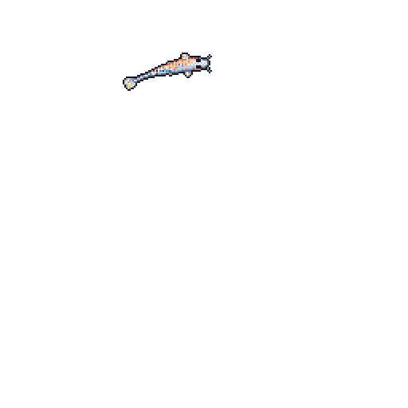

# Shardul Deshmukh

### About me!

Hey there! Hope you find my repos helpful. 👋

I'm a first-year CSE (Data Science) student at MIT AOE, and a total explorer when it comes to code. I like building small things, breaking them, and figuring out why.

**🌱 Currently learning**

- 📊 Data science and machine learning, starting from the basics
- ➗ Maths, the stuff that makes ML actually make sense
- ⚙️ C++ fundamentals
- 🌐 HTML, CSS and JavaScript

Contact: [Mail](mailto:sharduldeshmukh999@gmail.com) , [LinkedIn](https://www.linkedin.com/in/shardul-deshmukh-81ab08402/)

 

### 🔭 What I'm tinkering with

- **[Vertex-project-1](https://github.com/shardul999/Vertex-project-1)**: my first steps in game dev (GDScript)
- **[Eximius](https://github.com/shardul999/Eximius)**: a CSS playground

still learning · still curious 🐟
